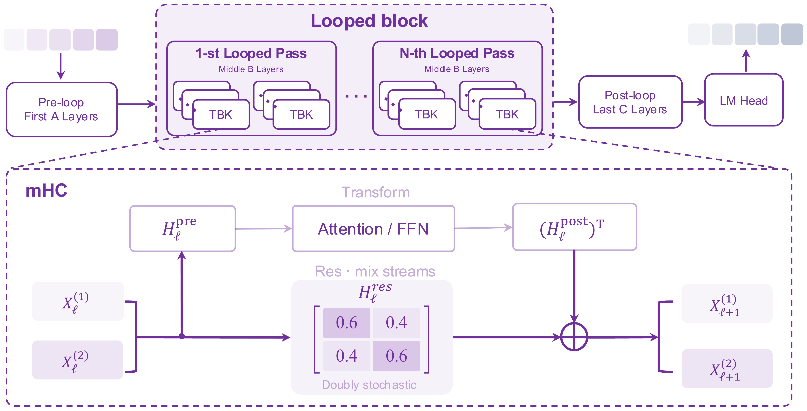
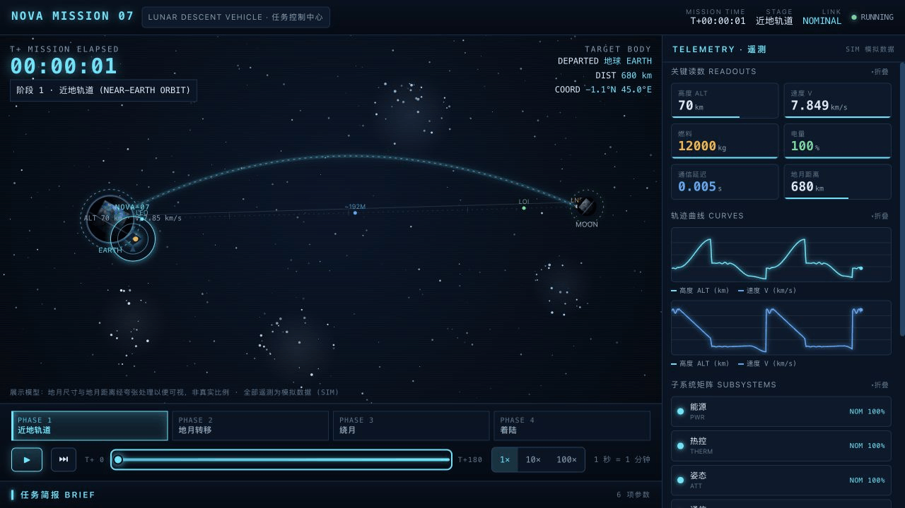
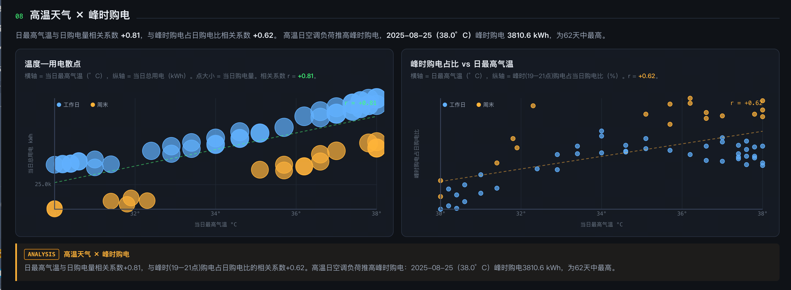
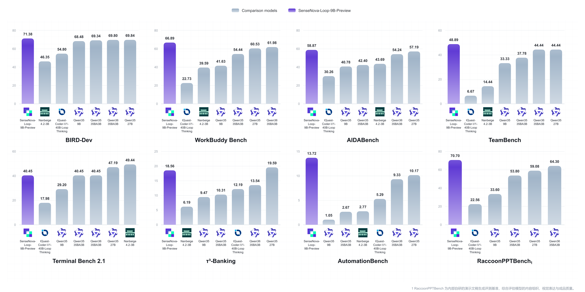

# SenseNova-6.8-Loop-9B-Preview

<p align="center">
  <strong>English</strong> | <a href="./README_CN.md">简体中文</a>
</p>



## 📣 News

- `[2026.10.30]` We release **SenseNova-6.8-Loop-9B-Preview**, a looped multimodal model for long-context and agentic workflows.

## 🚀 SenseNova-6.8-Loop-9B-Preview

### 🎬 Showcase (Created by Raccoon Work)

#### Motion Design

<a href="examples/ink-journey/ink-journey-demo.mp4"></a>


#### PPT Design


#### Data Analysis





## Overview

**SenseNova-6.8-Loop-9B-Preview** is a multimodal language model developed for long-context and agentic workflows. It accepts text and images and generates text for applications that combine document understanding, coding, and interaction with external tools.

The model combines a **looped decoder with two-stream manifold-constrained hyper-connections (mHC)**. A contiguous block of decoder layers is executed twice with shared weights, while learned mappings manage information flow between two residual streams in the looped section. Together, these components provide a deeper execution path without duplicating the repeated block's parameters.

Documented training recipes combine long sequences, multimodal inputs, and supervised task trajectories, with a maximum training sequence length of 262,144 tokens. For the best model performance, we recommend using our documented deployment environment and configuration parameters.

### Model highlights

- **Shared looped block:** 24 decoder layers are applied twice in sequence, producing 56 decoder-layer executions from 32 distinct layers.
- **Two-stream mHC:** learned mappings route and combine information across two residual streams in the looped section.
- **Hybrid attention:** the decoder interleaves linear and full attention in a repeating four-layer pattern.
- **Long-context multimodal training:** documented recipes include text, images, code, and tool trajectories at sequence lengths up to 256K tokens.

## 📊 Key Benchmarks



## Model specifications

| Property | SenseNova-6.8-Loop-9B-Preview |
| --- | --- |
| Architecture | Autoregressive multimodal decoder; looped block with two-stream mHC |
| Backbone scale | ~9B total parameters; ~14.6B inference parameters |
| Input / output | Text and images / text |
| Distinct decoder layers | 32 |
| Looped layers / passes | [4, 28) / 2, with shared weights |
| Decoder layer executions | 56 per forward pass |
| mHC streams | 2 |
| Training context | Up to 262,144 tokens |
| Existing export precision | BF16 backbone; FP32 mHC routing parameters |

## Model architecture

SenseNova-6.8-Loop-9B-Preview builds on a 32-layer multimodal decoder that combines shared-weight looped computation, hybrid attention, and two-stream manifold-constrained hyper-connections (mHC). The following sections describe how these components extend the computation path and manage information flow through the model.

### Looped decoder

The decoder first processes the input through layers 0–3. The same block of layers 4–27 is then applied twice in sequence, after which layers 28–31 and the output head produce the model's output. If *B* represents the repeated block and *h* its input, the looped computation can be written as **B(B(h))**.

The second pass takes the first pass's output as its input. Because both passes use the same layer weights, the model has **32 distinct decoder layers but 56 decoder-layer executions** per forward pass. Parameter sharing avoids duplicating the repeated block, while the additional pass still adds computation.

### Hybrid attention

The decoder interleaves linear-attention and full-attention layers. Each four-layer group contains three linear-attention layers followed by one full-attention layer. The loop boundaries align with complete four-layer groups, so the attention pattern is preserved across both passes.

### Two-stream mHC

Inside the looped section, mHC carries two residual streams around the decoder-layer computations. Learned mappings govern how a layer reads from the streams, mixes stream information, and incorporates the layer output into the residual state. Sinkhorn normalization constrains the stream-mixing map; the documented configuration uses 20 iterations.

The loop range, pass count, and mHC routing parameters form part of the checkpoint's execution configuration. A compatible inference implementation must load these parameters and reproduce the same execution order.

| Configuration | Value |
| --- | --- |
| Distinct decoder layers / executions | 32 / 56 |
| Repeated block / passes | [4, 28) / 2 |
| Hidden dimension | 4,096 |
| Feed-forward dimension | 12,288 |
| Vocabulary size | 248,320 |
| Full-attention heads / KV heads | 16 / 4 |
| mHC streams / Sinkhorn iterations | 2 / 20 |

## Inference acceleration

SenseNova-6.8-Loop-9B-Preview supports **MTP** for accelerated inference. **Dspark** and **Dflash2** are under development, with training currently in progress.

| Method | Status |
| --- | --- |
| MTP | Available |
| Dspark | Training in progress |
| Dflash2 | Training in progress |

Practical speedups depend on the workload, hardware, and serving configuration.

See [OpenSenseNova/SenseSpec](https://github.com/OpenSenseNova/SenseSpec) for our speculative decoding training code.

## Models and resources

| Resource | Status |
| --- | --- |
| Model weights | [Hugging Face model page](https://huggingface.co/sensenova/SenseNova-6.8-Loop-9B-Preview) |
| Transformers inference implementation | Publication details to be announced |
| Technical report | To be announced |

## Getting started

Use Transformers to load the model and its custom implementation from a prepared model directory. The example below runs text generation on a single GPU.

### Requirements

The checked inference environment uses **Transformers 5.18.0** and **PyTorch 2.11.0 with CUDA 13.0**. The model directory must include the configuration, tokenizer, chat template, model code, and accessible weight shards.

### Text generation with Transformers

Set `model_id` to the prepared model directory, then run:

```python
import torch
from transformers import AutoModelForCausalLM, AutoTokenizer

model_id = "/path/to/model-directory"
device = "cuda:0"

tokenizer = AutoTokenizer.from_pretrained(model_id, trust_remote_code=True)
model = AutoModelForCausalLM.from_pretrained(
    model_id,
    trust_remote_code=True,
    dtype=torch.bfloat16,
    device_map={"": device},
).eval()

messages = [{"role": "user", "content": "What is 13 times 7? Reply with the number only."}]
prompt = tokenizer.apply_chat_template(
    messages,
    tokenize=False,
    add_generation_prompt=True,
    enable_thinking=False,
)
inputs = tokenizer(prompt, return_tensors="pt").to(device)

with torch.inference_mode():
    outputs = model.generate(
        **inputs,
        max_new_tokens=256,
        do_sample=False,
        use_cache=True,
    )

response = tokenizer.decode(
    outputs[0, inputs.input_ids.shape[1]:],
    skip_special_tokens=True,
)
print(response)
```

The example uses greedy decoding and generates up to 256 new tokens. Set `enable_thinking=True` to enable thinking mode, or change `device` to select another GPU.

`trust_remote_code=True` loads the custom model implementation from the model directory. Review model code before loading it from an untrusted source. The example follows the previously validated single-GPU inference script; image input and tool calling are not covered by this example.

### Training

The model is trained using [OpenSenseNova/torchtitan](https://github.com/OpenSenseNova/torchtitan); see the `example/train` directory in the repository for training examples.

## License and citation

**License:** [Apache License 2.0](https://github.com/OpenSenseNova/SenseNova-6.8-Loop-9B-Preview/blob/main/LICENSE).<br>**Citation:** To be added with the release.
