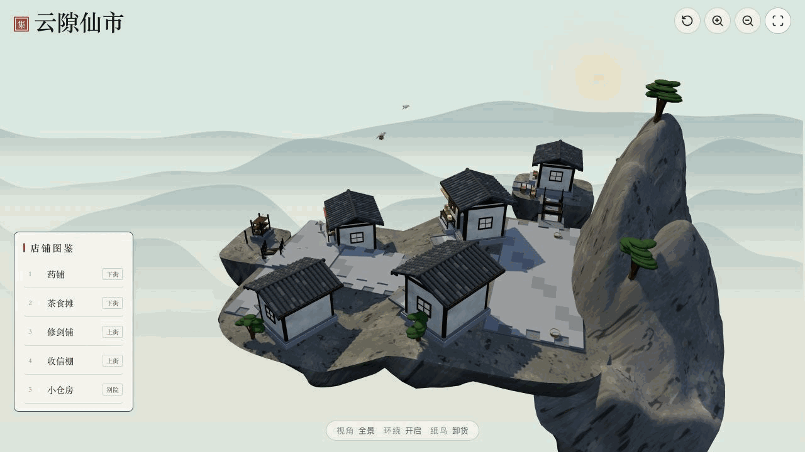
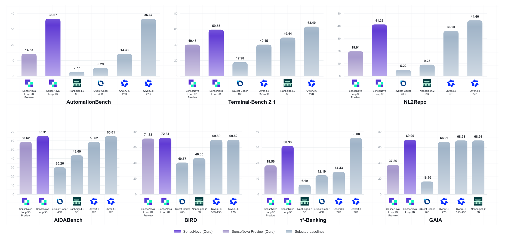
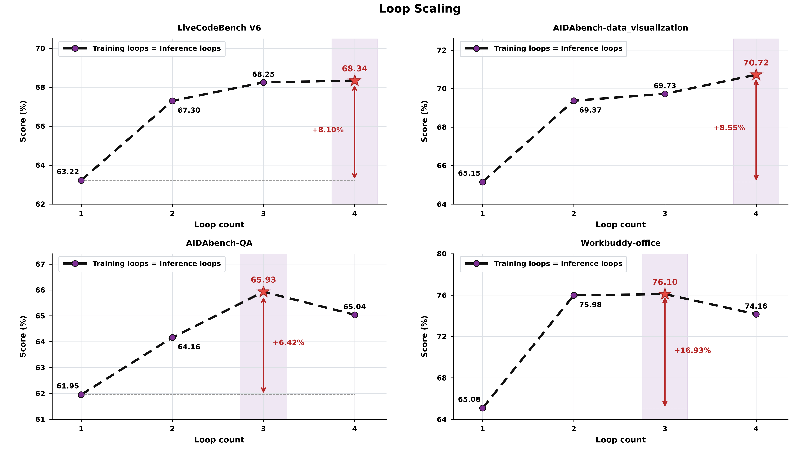

# SenseNova-Loop-9B

<p align="center">
  <a href="./README.md">English</a> | <strong>简体中文</strong>
</p>

<p align="center">
  <a href="https://huggingface.co/sensenova/SenseNova-Loop-9B"></a>
  <a href="https://huggingface.co/sensenova/SenseNova-Loop-9B-Preview"></a>
  <a href="https://modelscope.cn/models/sensenova/SenseNova-Loop-9B"></a>
  <a href="https://modelscope.cn/models/SenseNova/SenseNova-Loop-9B-Preview"></a>
  <a href="https://github.com/OpenSenseNova/SenseNova-Loop"></a>
  <a href="https://github.com/OpenSenseNova/SenseNova-Loop/blob/main/LICENSE"></a>
  <a href="https://huggingface.co/sensenova/SenseNova-Loop-9B-Preview/blob/main/config.json"></a>
  <a href="https://discord.com/invite/BuTXPHmQub"></a>
</p>

## 🌐 模型架构


## 📣 News

**🔥 2026-11-18：** 新增 [AWQ](https://huggingface.co/sensenova/SenseNova-Loop-9B-AWQ) 和 [GGUF](https://huggingface.co/sensenova/SenseNova-Loop-9B-GGUF) 权重下载入口。

**🔥 2026-11-17：** 我们正式发布 SenseNova-Loop-9B，开放模型权重与相关代码，欢迎社区下载、部署和探索。

**🔥 2026-10-31：** 我们推出 SenseNova-Loop-9B-Preview，开放模型权重与相关代码。

## 🚀 SenseNova-Loop-9B：让更少的参数走更深的计算路径

我们正式发布 SenseNova-Loop-9B。该模型**延续了 Preview 版本对参数效率的探索**：通过 Loop 结构复用模型层的参数，并结合流形约束超连接（mHC），在有限的参数规模下扩展计算深度，面向复杂推理、代码、工具调用和多模态任务。

Preview 发布以来，我们收到了**社区对模型使用、推理部署和生态适配的关注与反馈**。正式版**沿用** Loop 与双流 mHC 的模型结构，**进一步优化**模型在 Agent、代码与数据分析任务中的表现，并继续探索循环计算的能力边界。

SenseNova-Loop-9B 使用约 9B 的模型参数，通过循环执行共享的中间层，将 32 个物理解码层扩展为 56 次层计算。模型支持文本与图像输入、文本输出，面向长上下文理解与多步任务。在 Agent 与数据分析评测中，模型展现出与 Qwen3.8-27B 相当的竞争力：NL2Repo 达到 41.36，接近其 44.60；AIDABench 达到 65.31，略高于其 65.01。

### 模型亮点
- **共享循环模块**：24 个解码器层依次执行两遍，使 32 个独立层在一次前向传播中完成 56 次层计算。
- **双流 mHC**：通过可学习映射，对循环模块中两条残差流的信息进行路由与融合。
- **混合注意力**：解码器以四层为一组，交替使用线性注意力与全注意力。
- **长上下文多模态**：训练方案涵盖文本、图像、代码和工具调用轨迹，上下文长度扩展至 512K tokens。
- **低显存部署**：使用 4-bit 权重和 8-bit KV 缓存时，256K 上下文多模态推理的显存需求约为 15 GiB。
- **官方量化版同步提供**：模型发布首日提供官方 AWQ 4-bit 量化版本，方便用户快速部署。

## 🎬 Showcase

### 3D



### SVG + Web


### Poster


### Web


### Design


## 📊 模型能力：从 Preview 到正式版

我们围绕 **Agent、代码和数据分析任务**评测 SenseNova-Loop-9B，并将正式版与 Preview 及其他模型进行比较。



正式版在图示的七项评测中均超过 Preview。在 AutomationBench 上，得分从 14.33 提升至 36.67；Terminal-Bench 2.1 从 40.45 提升至 59.55；GAIA 从 37.86 提升至 69.90。

与 Qwen3.8-27B 相比，正式版在 AutomationBench 上同为 36.67，在 AIDABench 上以 65.31 略高于 65.01；NL2Repo 得分为 41.36，接近其 44.60。BIRD 得分为 72.34，相比 Preview 的 71.38 提升 0.96 个百分点。

## 🧠 模型结构

SenseNova-Loop-9B 以 32 层多模态解码器为基础，将共享权重的循环计算、混合注意力和双流流形约束超连接（mHC）结合在一起。模型通过复用中间层参数扩展计算深度，支持文本与图像输入、文本输出，并支持最长 512K token 的上下文。

### 模型规格

| 项目 | SenseNova-Loop-9B |
|-|-|
| 架构 | 自回归多模态解码器；循环模块采用双流 mHC |
| 参数规模 | 总共约 9B 参数，推理等效参数规模约 14.6B |
| 输入 / 输出 | 文本和图像 / 文本 |
| 独立解码器层数 | 32 |
| 循环层范围 / 执行次数 | [4, 28) / 2 次，共享权重 |
| 解码器层执行次数 | 每次前向传播执行 56 次 |
| mHC 残差流数量 | 2 |
| 上下文长度 | 512K tokens |
| 权重精度 | 主干为 BF16；mHC 路由参数为 FP32 |

#### 循环解码器

输入首先经过第 0–3 层，随后依次通过同一组第 4–27 层两次，最后由第 28–31 层和输出头生成模型输出。若用 B 表示循环模块、h 表示其输入，则循环计算可写为 B(B(h))。

推理时，模型每次前向传播完成 56 次解码器层计算，只需存储 32 层解码器权重。循环模块在两次执行中复用同一组权重，第二次执行以第一次的输出作为输入。

#### 混合注意力

解码器交替使用线性注意力层与全注意力层。每四层为一组，依次包含三层线性注意力和一层全注意力。循环模块的边界与完整的四层组对齐，因此两次执行都保持相同的注意力排列。

#### 双流 mHC

在循环模块中，mHC 使用两条残差流传递解码器层计算前后的信息。可学习映射决定各层如何读取残差流、混合流间信息，以及将层输出写入残差状态。流间混合映射采用 Sinkhorn 归一化进行约束；模型配置使用 20 次迭代。

可以将两条残差流理解为并行传递的两组隐藏状态：每个循环层先从残差流读取信息，执行注意力或前馈计算，再把结果写回。流间混合矩阵通过反复进行行、列归一化，约束信息在两条流之间的混合；这 20 次归一化迭代属于 mHC 内部计算，与循环模块执行两遍是不同的步骤。

循环层范围、执行次数和 mHC 路由参数共同构成模型检查点的执行配置。兼容的推理实现需要加载这些参数，并保持相同的计算顺序。

| 配置 | 数值 |
|-|-|
| 独立解码器层数 / 执行次数 | 32 / 56 |
| 循环层范围 / 执行次数 | [4, 28) / 2 |
| 隐藏层维度 | 4,096 |
| 前馈网络维度 | 12,288 |
| 词表大小 | 248,320 |
| 全注意力头数 / KV 头数 | 16 / 4 |
| mHC 残差流数量 / Sinkhorn 迭代次数 | 2 / 20 |

## 🔬 Loop Scaling：探索循环计算的收益



Looped Transformer 展现出良好的性能扩展潜力，为模型能力提升提供了循环计算这一新的探索维度。以原版 9B 模型（即图中对应标准单次前向计算的 Loop 1）为基准，我们在保持训练数据等配置一致的条件下，探索了循环计算的 Scaling 效果。实验结果表明，随着训练与推理循环次数的同步增加，四项核心任务的表现整体提升，最优结果出现在 3–4 次循环。具体而言，AIDAbench-QA 和 Workbuddy-office 任务在 3 次循环时表现最佳，较 9B 基准分别提升了 6.42% 和 16.93%；而在 LiveCodeBench V6 和 AIDAbench-data_visualization 任务中，4 次循环则进一步推高了模型表现，分别实现了 8.10% 和 8.55% 的性能增长。

综合考虑实际应用中的推理效率，我们当前的 Preview 和正式版模型均默认采用 2 次循环。然而，深层循环所带来的性能增益依然客观存在。以代码生成（LiveCodeBench V6）和数据可视化（AIDAbench-data_visualization）这两项较为复杂的任务为例，若将循环次数从当前的 2 次增加至 4 次，模型得分仍能分别获得 1.04 和 1.35 个百分点的提升。这一结果印证了 Loop Scaling 的有效性，也表明当前的 1 到 4 次实验只是一个起点，更高循环深度所蕴含的能力空间仍值得进一步挖掘。

此外，上述实验结果也直观地反映出，不同类型任务对循环深度的需求存在显著差异。基于这一观察，在后续的研究中，我们不仅会继续探索更高循环深度的能力边界，还将重点研究动态循环（Dynamic Loop）架构。该架构旨在让模型能够根据输入任务的复杂程度，自适应地匹配最优的循环次数，从而在确保复杂任务获得充分算力的同时，兼顾整体的推理效率。

## 💾 低显存硬件部署友好

得益于 Loop 的循环共享结构，模型仅需约 9B 独立参数，4-bit 量化后权重体积约为 4.9 GB。结合 8-bit 或 4-bit KV 缓存，可以进一步降低长上下文推理的显存需求。不同上下文长度和 KV 缓存精度下，模型部署的最低显存需求如下：

| 上下文长度 | 8-bit KV 缓存 | 4-bit KV 缓存 |
| --- | ---: | ---: |
| 64K | 约 10 GiB | 约 9 GiB |
| 128K | 约 12 GiB | 约 10 GiB |
| 256K | 约 15 GiB | 约 12 GiB |

## Get Started

### 模型权重

| 权重 | 下载 | 文件说明 |
| --- | --- | --- |
| BF16 | [Hugging Face](https://huggingface.co/sensenova/SenseNova-Loop-9B) · [ModelScope](https://modelscope.cn/models/sensenova/SenseNova-Loop-9B) | 正式版 Safetensors 权重 |
| AWQ | [Hugging Face](https://huggingface.co/sensenova/SenseNova-Loop-9B-AWQ) | 4-bit AWQ 权重与配套 MTP |
| GGUF | [Hugging Face](https://huggingface.co/sensenova/SenseNova-Loop-9B-GGUF) | BF16、Q8_0、Q5_K_M、Q4_K_M |

### 使用 Transformers 生成文本

使用 Transformers 从 Hugging Face 仓库或本地模型目录加载模型。下方示例展示单张 GPU 上的文本生成，以及使用推理引擎启动服务的方法。

#### 环境要求

Preview 已验证的环境使用 Transformers 5.18.0、PyTorch 2.11.0 和 CUDA 13.0。模型目录需要包含配置、分词器、对话模板、自定义模型代码和全部权重分片。

先安装与 CUDA 环境兼容的 [PyTorch](https://pytorch.org/get-started/locally/)，再安装其余依赖：

```bash
python -m pip install "transformers==5.18.0" accelerate safetensors
```

将 model_id 替换为正式版权重目录或模型仓库 ID，然后运行：

```python
import torch
from transformers import AutoModelForCausalLM, AutoTokenizer

model_id = "/path/to/SenseNova-Loop-9B"
device = "cuda:0"

tokenizer = AutoTokenizer.from_pretrained(model_id, trust_remote_code=True)
model = AutoModelForCausalLM.from_pretrained(
    model_id,
    trust_remote_code=True,
    dtype=torch.bfloat16,
    device_map={"": device},
).eval()

messages = [{"role": "user", "content": "13 乘以 7 等于多少？"}]
prompt = tokenizer.apply_chat_template(
    messages,
    tokenize=False,
    add_generation_prompt=True,
    enable_thinking=True,
)
inputs = tokenizer(prompt, return_tensors="pt").to(device)
with torch.inference_mode():
    outputs = model.generate(
        **inputs,
        max_new_tokens=512,
        do_sample=False,
        use_cache=True,
    )
response = tokenizer.decode(
    outputs[0, inputs.input_ids.shape[1]:],
    skip_special_tokens=True,
)
print(response)
```

示例开启思考模式，采用贪心解码并最多生成 512 个新 token。将 enable_thinking 设为 False 可关闭思考模式；修改 device 可选择 GPU。trust_remote_code=True 用于加载 SenseNova Loop 的自定义模型实现。

### 部署

以下命令参考 Preview 的部署示例，将路径替换为正式版权重目录；正式版对应的引擎版本与配置随发布更新。

#### LightLLM

以下为四卡 GPU 部署示例：

```bash
docker pull ghcr.io/modeltc/lightllm:main

docker run --rm --gpus all --ipc=host -p 8000:8000 \
  -v /path/to/SenseNova-Loop-9B:/model \
  -e LOADWORKER=4 -e LIGHTLLM_TRITON_AUTOTUNE_LEVEL=1 \
  ghcr.io/modeltc/lightllm:main \
  python -m lightllm.server.api_server \
    --model_dir /model --model_name SenseNova-Loop-9B \
    --tp 4 --host 0.0.0.0 --port 8000
```

服务启动后，可以发送 OpenAI 兼容请求：

```bash
curl http://localhost:8000/v1/chat/completions \
  -H 'Content-Type: application/json' \
  -d '{"model": "SenseNova-Loop-9B", "messages": [{"role": "user", "content": "Hello!"}], "max_tokens": 128}'
```

#### SGLang

使用包含 SenseNova Loop 实现的 [SGLang PR #47281](https://github.com/sgl-project/sglang/pull/47281) 对应版本，并替换模型路径：

```bash
git clone https://github.com/sgl-project/sglang.git
cd sglang
git fetch origin pull/47281/head
git checkout -b sensenova-loop FETCH_HEAD
python -m pip install -e ./python

sglang serve --model-path /path/to/SenseNova-Loop-9B
```

#### vLLM

使用包含 SenseNova Loop 实现的 [vLLM PR #64832](https://github.com/vllm-project/vllm/pull/64832) 对应版本，并替换模型路径：

```bash
git clone https://github.com/vllm-project/vllm.git
cd vllm
git fetch origin pull/64832/head
git checkout -b sensenova-loop FETCH_HEAD
python -m pip install -e .

vllm serve /path/to/SenseNova-Loop-9B \
  --served-model-name sensenova_loop \
  --tensor-parallel-size 4 \
  --dtype bfloat16
```

### 推理加速

SenseNova-Loop 支持 MTP 推测解码。DSpark 和 DFlash2 的 draft model 训练方法见 [SenseSpec](https://github.com/OpenSenseNova/SenseSpec)；正式版可用的 draft 权重和启动参数将在发布时更新。

## 🏋️ Training

模型微调可参考 [OpenSenseNova/torchtitan](https://github.com/OpenSenseNova/torchtitan) 中的 SenseNova-Loop 示例。

推测解码 draft model 的 DSpark 和 DFlash2 训练脚本见 [OpenSenseNova/SenseSpec](https://github.com/OpenSenseNova/SenseSpec)。

## ⚠️ 已知局限

受模型体量和迭代时间限制，SenseNova-Loop-9B 在以下方面仍有改进空间：

- **复杂指令跟随**：面对较多、较复杂的工具定义或多重条件约束时，模型可能出现理解与执行偏差。
- **代码与通用 Agent 能力**：模型在代码和通用 Agent 任务中的表现仍有稳定性不足的情况，可以通过更多步骤修正部分错误；处理复杂长程任务的能力仍需提升。
- **复杂网页生成**：包含复杂 3D 场景和丰富动态元素的网页未必能单轮完成，部分案例需要结合用户反馈，经过 2–3 轮修复才能达到较好的效果。

我们将持续改进模型，并计划在未来将 Loop 架构应用于更大规模的模型。欢迎社区分享使用反馈和问题案例。

## 📄 License 与引用

模型项目采用 [Apache License 2.0](https://github.com/OpenSenseNova/SenseNova-Loop/blob/main/LICENSE)。

---
