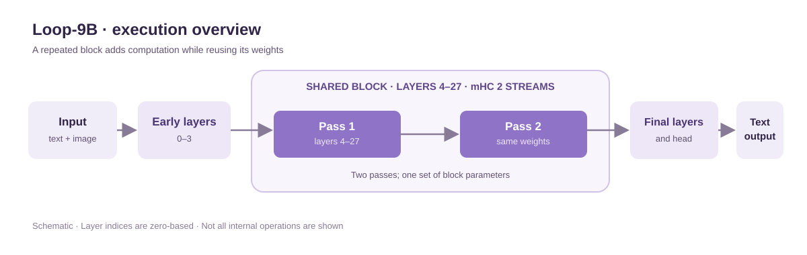

# SenseNova-6.8-Loop-9B-Preview

<p align="center">
  <a href="./README.md">English</a> | <strong>简体中文</strong>
</p>


## 📣 最新动态

- `[2026.10.30]` 我们发布了 **SenseNova-6.8-Loop-9B-Preview**，一个面向长上下文与智能体工作流的循环多模态模型。

## 🚀 SenseNova-6.8-Loop-9B-Preview

### 🎬 效果展示（由商汤小浣熊创作）

#### 动效设计

[](examples/ink-journey/ink-journey-demo.mp4)

#### PPT 设计


#### 数据分析


## 模型概述

**SenseNova-6.8-Loop-9B-Preview** 是一个面向长上下文和智能体工作流的多模态语言模型。模型接收文本和图像输入，生成文本输出，适用于结合文档理解、编程及外部工具交互的应用。

模型将**循环解码器与双流流形约束超连接（mHC）**相结合。一段连续的解码器层共享权重，依次执行两遍；循环模块中的可学习映射负责管理两条残差流之间的信息流动。通过这种设计，模型无需复制循环模块的参数，就能增加实际执行深度。

已有训练方案结合了长序列、多模态输入和带监督的任务轨迹，最长训练序列为 262,144 个 token。模型的实际表现和部署限制取决于发布的模型检查点及推理实现。

### 模型亮点

- **共享循环模块：**24 个解码器层依次执行两遍，使 32 个独立层在一次前向传播中完成 56 次层计算。
- **双流 mHC：**通过可学习映射，对循环模块中两条残差流的信息进行路由与融合。
- **混合注意力：**解码器以四层为一个循环单元，交替使用线性注意力与全注意力。
- **长上下文多模态训练：**已有训练方案涵盖文本、图像、代码和工具调用轨迹，序列长度最长为 256K token。

## 📊 核心评测


## 模型规格

| 项目 | SenseNova-6.8-Loop-9B-Preview |
| --- | --- |
| 架构 | 自回归多模态解码器；循环模块采用双流 mHC |
| 参数规模 | 总共约 9B 参数，推理实际约 14.6B 参数 |
| 输入 / 输出 | 文本和图像 / 文本 |
| 独立解码器层数 | 32 |
| 循环层范围 / 执行次数 | [4, 28) / 2 次，共享权重 |
| 解码器层执行次数 | 每次前向传播执行 56 次 |
| mHC 残差流数量 | 2 |
| 训练上下文长度 | 最长 262,144 个 token |
| 现有导出精度 | 主干为 BF16；mHC 路由参数为 FP32 |

训练序列长度属于训练配置，并不代表推理实现支持所有对应长度，也不构成各长度下的性能保证。

## 模型架构

SenseNova-6.8-Loop-9B-Preview 采用 32 层多模态解码器，其中的中间层模块会重复执行。下图展示了计算顺序，省略了各层内部操作和视觉编码器的细节。



*图 1：解码器的执行顺序。层编号从 0 开始，两次循环执行共享模块权重。*

### 循环解码器

输入首先经过第 0–3 层，随后依次通过同一组第 4–27 层两次，最后由第 28–31 层和输出头生成模型输出。若用 *B* 表示循环模块、*h* 表示其输入，则循环计算可写为 **B(B(h))**。

第二次执行以第一次的输出作为输入。由于两次执行共享层权重，模型拥有 **32 个独立解码器层，但每次前向传播会执行 56 次解码器层计算**。参数共享避免了复制循环模块，但额外执行一遍仍会增加计算量。

### 混合注意力

解码器交替使用线性注意力层与全注意力层。每四层为一组，依次包含三层线性注意力和一层全注意力。循环模块的边界与完整的四层组对齐，因此两次执行都保持相同的注意力排列。

### 双流 mHC

在循环模块中，mHC 使用两条残差流传递解码器层计算前后的信息。可学习映射决定各层如何读取残差流、混合流间信息，以及将层输出写入残差状态。流间混合映射采用 Sinkhorn 归一化进行约束；已有配置使用 20 次迭代。

循环层范围、执行次数和 mHC 路由参数共同构成模型检查点的执行配置。兼容的推理实现需要加载这些参数，并保持相同的计算顺序。

| 配置 | 数值 |
| --- | --- |
| 独立解码器层数 / 执行次数 | 32 / 56 |
| 循环层范围 / 执行次数 | [4, 28) / 2 |
| 隐藏层维度 | 4,096 |
| 前馈网络维度 | 12,288 |
| 词表大小 | 248,320 |
| 全注意力头数 / KV 头数 | 16 / 4 |
| mHC 残差流数量 / Sinkhorn 迭代次数 | 2 / 20 |

## 推理加速

SenseNova-6.8-Loop-9B-Preview 已支持 **MTP** 推理加速。**Dspark** 和 **Dflash2** 正在开发中，目前处于训练阶段。

| 方法 | 状态 |
| --- | --- |
| MTP | 已可用 |
| Dspark | 训练中 |
| Dflash2 | 训练中 |

实际加速效果取决于任务负载、硬件和服务配置。

投机解码训练代码请参见 [OpenSenseNova/SenseSpec](https://github.com/OpenSenseNova/SenseSpec)。

## 模型与资源

| 资源 | 状态 |
| --- | --- |
| 模型权重 | [Hugging Face 模型页面](https://huggingface.co/sensenova/SenseNova-6.8-Loop-9B-Preview) |
| Transformers 推理实现 | 发布详情待公布 |
| 技术报告 | 待公布 |

## 快速开始

使用 Transformers 从准备好的模型目录中加载模型及其自定义实现。下面的示例展示了如何在单张 GPU 上进行文本生成。

### 环境要求

已核对的推理环境使用 **Transformers 5.18.0** 和 **PyTorch 2.11.0（CUDA 13.0）**。模型目录需要包含配置、分词器、对话模板、模型代码，以及可访问的权重分片。

### 使用 Transformers 生成文本

将 `model_id` 设置为准备好的模型目录，然后运行：

```python
import torch
from transformers import AutoModelForCausalLM, AutoTokenizer

model_id = "/path/to/model-directory"
device = "cuda:0"

tokenizer = AutoTokenizer.from_pretrained(model_id, trust_remote_code=True)
model = AutoModelForCausalLM.from_pretrained(
    model_id,
    trust_remote_code=True,
    dtype=torch.bfloat16,
    device_map={"": device},
).eval()

messages = [{"role": "user", "content": "13 乘以 7 等于多少？只回答数字。"}]
prompt = tokenizer.apply_chat_template(
    messages,
    tokenize=False,
    add_generation_prompt=True,
    enable_thinking=False,
)
inputs = tokenizer(prompt, return_tensors="pt").to(device)

with torch.inference_mode():
    outputs = model.generate(
        **inputs,
        max_new_tokens=256,
        do_sample=False,
        use_cache=True,
    )

response = tokenizer.decode(
    outputs[0, inputs.input_ids.shape[1]:],
    skip_special_tokens=True,
)
print(response)
```

示例采用贪心解码，最多生成 256 个新 token。将 `enable_thinking=True` 可开启思考模式，修改 `device` 可选择其他 GPU。

`trust_remote_code=True` 会从模型目录加载自定义模型实现。加载不可信来源的模型前，请先检查模型代码。此示例沿用此前已验证的单卡推理脚本，不包含图像输入和工具调用。

### 训练

模型训练使用 [OpenSenseNova/torchtitan](https://github.com/OpenSenseNova/torchtitan) 中的代码，训练示例请参见仓库中的 `example/train` 目录。

## 许可证与引用

**许可证：**发布权重与代码所适用的许可证待确定。<br>**引用：**将在发布时补充。
